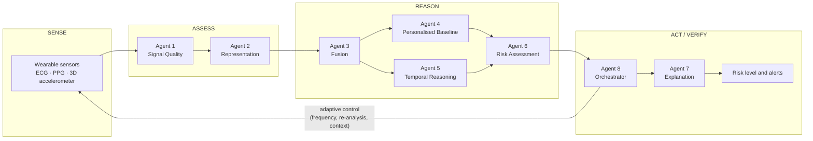
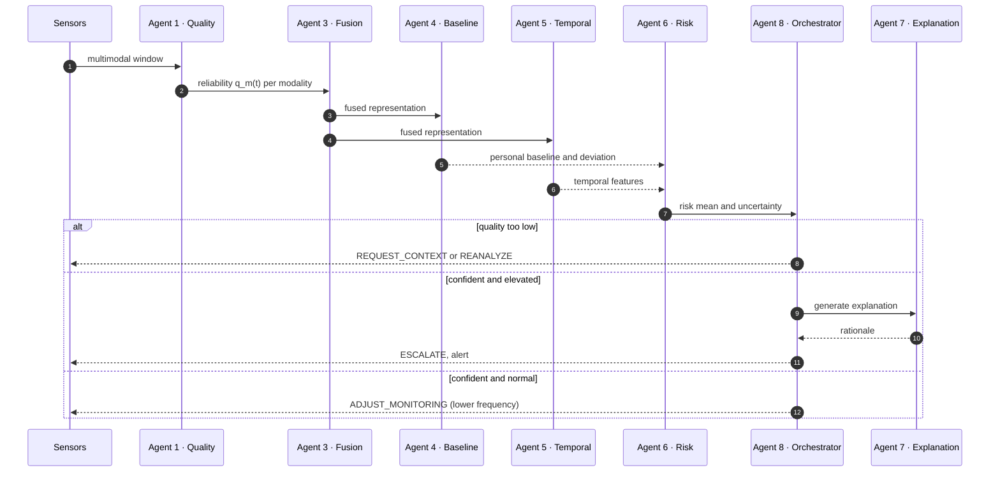
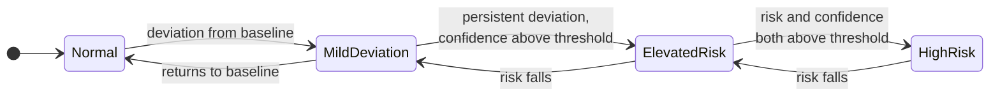

# AMPA-HR: Autonomous Multimodal Agentic AI for Personalized Physiological Monitoring

**AMPA-HR** (Autonomous Multimodal Physiological Agent for Health-Risk Assessment) is an agentic AI framework that
monitors wearable physiological signals and estimates the probability of an adverse health event. Instead of running a
fixed pipeline, it uses eight specialised agents coordinated by an orchestrator in a closed
**sense → assess → reason → act → verify** loop.

> **Research prototype.** AMPA-HR is not a medical device and is not validated for clinical use. Its outputs are risk
> estimates from research data, not diagnoses.

Paper: *An Autonomous Multimodal Agentic AI Framework for Personalized Physiological Monitoring and Early Health-Risk
Assessment Using Wearable Sensors*, IEEE INDICON 2026, Chennai.  
Authors: Rithanya Raj (IIITDM Kancheepuram, ECE) and Anjan Mahapatra (IIITDM Kancheepuram, Mechanical Engineering).

## Contents

- [Why AMPA-HR](#why-ampa-hr)
- [Architecture](#architecture)
- [The eight agents](#the-eight-agents)
- [Method](#method)
- [Experimental setup](#experimental-setup)
- [Results](#results)
- [Ablation and robustness](#ablation-and-robustness)
- [Limitations](#limitations)
- [Getting started](#getting-started)
- [Citation](#citation)

## Why AMPA-HR

Most wearable monitoring pipelines share three weaknesses, which the paper identifies:

1. **Population-level models** ignore that physiological baselines differ between people.
2. **Static sensing** has no way to handle sensor drift or motion artefacts. Systems either discard data or degrade quietly.
3. **Fixed decision logic** runs the same steps regardless of signal quality or uncertainty.

AMPA-HR addresses all three. It builds a personal baseline for each person, weights each sensor by its current
reliability, and chooses what to do next based on state and confidence.

## Architecture

The overall flow runs from raw wearable data to a risk alert, with an explanation and a feedback loop back to sensing.



## The eight agents

| Agent | Role | What it produces |
| --- | --- | --- |
| 1. Signal Quality | Scores each modality in real time using SNR, artefact rate, missing fraction and plausibility | Reliability estimate `q_m(t)` per modality |
| 2. Representation | Modality-specific temporal convolutional encoders (64-dimensional outputs) | Features `h_m,k`: R-peaks and HRV for ECG, pulse features and SpO₂ for PPG, activity for accelerometry |
| 3. Fusion | Quality-weighted fusion across modalities, with modality dropout for missing channels | Fused representation `z_k` |
| 4. Personalised Baseline | Neural ODE that updates each person's baseline `B_i(t)` online, conditioned on circadian phase and activity | Individual baseline and deviation from it |
| 5. Temporal Reasoning | Transformer with temporal attention over a sliding window | Short- and long-term dynamics, cross-modal links, circadian patterns |
| 6. Risk Assessment | Predicts adverse-event probability with Monte Carlo dropout | Mean risk `R̂` and uncertainty `σ̂` |
| 7. Explanation | SHAP and attention attribution rendered as a short rationale | Human-readable explanation grounded in model evidence |
| 8. Orchestrator | Learns a policy over actions and sampling frequency | Chosen action from the action set below |

The orchestrator chooses from this action set:

`ANALYZE · REANALYZE · REQUEST_CONTEXT · FUSE_MODALITIES · ASSESS_RISK · VERIFY · GENERATE_EXPLANATION · ADJUST_MONITORING · ESCALATE · WAIT`

Each risk estimate falls into one of four levels: **Normal**, **Mild Deviation**, **Elevated Risk**, or **High Risk**.

### Per-request flow



### Risk levels



The thresholds are the paper's decision rules. The exact values are set in the implementation, not in the paper.

## Method

**Problem.** For each person *i* and modality *m*, the signal over a window *T* is modelled as true signal plus artefact
plus noise. The goal is to estimate the probability of an adverse event at a horizon `t + Δt`. The paper targets latency
under 100 ms, personalisation, robustness to at least 30% missing data, and explanations a clinician can read.

**Reliability-aware fusion.** Fixed fusion weights ignore signal quality. AMPA-HR weights each modality by its
reliability, combining current quality with its historical reliability and task relevance.

**Personalised baseline.** A neural ODE models how each person's baseline changes over time:

`dB_i(t)/dt = G_i(B_i(t), C_i(t); θ_i)`

where `C_i(t)` holds circadian phase and activity level. Deviation from this baseline is measured with a
Mahalanobis-style distance, so a reading that is normal for one person can still trigger an alarm for another.

**Uncertainty.** Monte Carlo dropout gives the mean and spread of the risk estimate:

`R̂_i(t) = (1/N_mc) Σ R_i^(n)(t)` and `σ̂_i(t)` as the standard deviation across the same passes.

**Decision-making.** The problem is framed as a partially observable Markov decision process. The orchestrator learns a
policy `π(a_t | S_t)` that trades off early detection, false alarms and the cost of each action.

## Experimental setup

- **Dataset:** PPG-DaLiA, augmented with synthetic health events and sensor dropouts.
- **Signals:** ECG at 700 Hz and PPG and 3D accelerometer at 100 Hz, resampled to 100 Hz. Band-pass filtered
  (0.5–40 Hz for ECG, 0.5–10 Hz for PPG) and artefact-corrected.
- **Windows:** 60-second sliding windows with 50% overlap.
- **Split:** subject-independent 60/20/20 for training, validation and testing. Each subject gets a 10-minute
  adaptation period for personalisation.
- **Baselines:** logistic regression, random forest, XGBoost, LSTM, GRU, CNN-LSTM, TCN, Transformer, multimodal
  transformer, personalised ML, and a late-fusion model.
- **Metrics:** classification (accuracy, precision, recall, F1, AUROC, AUPRC, sensitivity, specificity), early
  detection (lead time, false alarms per hour), calibration (calibration error, Brier score), and agentic
  metrics (action-selection accuracy, task completion, invalid-action rate, inference latency).

## Results

### Comparison with baselines

| Model | AUROC | F1 | Lead time (min) |
| --- | --- | --- | --- |
| Logistic Regression | 0.712 | 0.684 | 2.3 |
| Random Forest | 0.745 | 0.712 | 3.1 |
| XGBoost | 0.768 | 0.735 | 4.2 |
| LSTM | 0.821 | 0.789 | 6.7 |
| Transformer | 0.852 | 0.812 | 8.4 |
| Multimodal Transformer | 0.897 | 0.856 | 11.2 |
| Personalised ML | 0.871 | 0.834 | 9.8 |
| **AMPA-HR** | **0.942** | **0.901** | **15.9** |

AMPA-HR also has the lowest false-alarm rate reported, at 0.4 alarms per hour.

### Personalisation settings

| Setting | Subject AUROC (mean ± std) | Calibration error |
| --- | --- | --- |
| Population (A) | 0.784 ± 0.052 | 0.124 |
| Static personalised (B) | 0.841 ± 0.041 | 0.089 |
| **Adaptive agentic (C)** | **0.917 ± 0.032** | **0.041** |

### Agentic efficiency

- Orchestrator accuracy: 94.2%
- Task completion rate: 96.8%
- Invalid action rate: 2.1%
- Inference latency: 47 ms

## Ablation and robustness

Removing one component at a time from the full model (AUROC 0.942):

| Variant | AUROC | False alarms per hour |
| --- | --- | --- |
| Full AMPA-HR | 0.942 | 0.4 |
| No personalisation | 0.873 | 1.3 |
| No orchestration | 0.891 | 0.9 |
| No multimodal fusion | 0.905 | 1.1 |
| No temporal reasoning | 0.912 | 0.8 |
| No signal quality | 0.918 | 1.2 |
| No uncertainty | 0.925 | 0.9 |
| Static orchestration | 0.886 | 0.9 |
| ECG only | 0.784 | 2.1 |
| PPG only | 0.756 | 2.3 |
| ECG + PPG | 0.861 | 1.3 |
| ECG + PPG + activity | 0.907 | 0.6 |

Personalisation and orchestration have the largest effects. Removing personalisation costs the most AUROC, and
single-sensor models perform worst, so combining modalities matters.

**Robustness.** With 30% of data missing, AUROC falls only from 0.942 to 0.907, a 3.7% drop. With ECG corrupted, it
falls from 0.942 to 0.922. The signal-quality agent flags unreliable modalities, and fusion re-weights the rest.

## Limitations

- **Not clinically validated.** The paper names EHR integration and clinical validation as future work.
- **Synthetic events.** Health events are partly synthetic. Real-world adverse-event performance is untested.
- **One dataset.** All results come from PPG-DaLiA, which has a small number of subjects.
- **Latency claim.** The paper reports 47 ms inference latency. Edge deployment is listed as future work.
- **Explanations** are model-derived. They show what drove a score, not a verified medical cause.

## Getting started

No code accompanies the paper yet, so there is no install or run command to give.

Planned next steps, according to the paper:

- Real-time edge deployment
- EHR integration
- Clinical validation

If you're reproducing the work, the inputs are PPG-DaLiA signals at the sample rates above, with the windowing and
split described in [Experimental setup](#experimental-setup).

## Citation

```bibtex
@inproceedings{raj2026ampahr,
  title     = {An Autonomous Multimodal Agentic AI Framework for Personalized Physiological Monitoring and Early Health-Risk Assessment Using Wearable Sensors},
  author    = {Raj, Rithanya and Mahapatra, Anjan},
  booktitle = {IEEE INDICON},
  year      = {2026},
  address   = {Chennai, India}
}
```

## References

The paper's reference list covers wearable sensing, multimodal deep learning, foundation models for physiological
signals, neural ODEs for personalised monitoring, multi-agent systems in healthcare, and the PPG-DaLiA dataset
(Reiss and Stricker). See the paper's bibliography for full entries.


